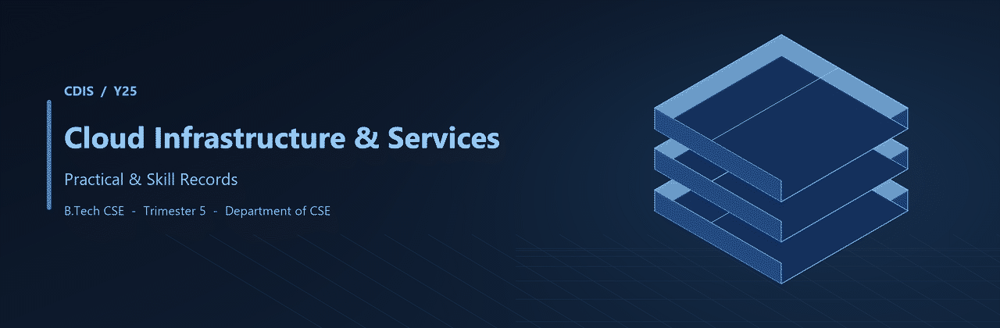

<p align="center">
  
</p>

<p align="center">
  <a href="https://img.shields.io/badge/Course-Cloud%20Infrastructure%20%26%20Services-0A66C2"></a>
  <a href="https://img.shields.io/badge/Program-B.Tech%20CSE-1F6FEB"></a>
  <a href="https://img.shields.io/badge/Trimester-5-2EA043"></a>
  <a href="https://img.shields.io/badge/Status-Complete-2EA043"></a>
</p>

Structured, verified lab records for the **Cloud Infrastructure and Services (25CS2206E)** course. Each record follows the prescribed institutional format and includes the aim, theory, procedure, result and output evidence.

---

## Contents

- [Overview](#overview)
- [Record index](#record-index)
- [Repository structure](#repository-structure)
- [Record details](#record-details)
- [Workstation and toolchain](#workstation-and-toolchain)
- [Documentation standard](#documentation-standard)
- [Using this repository](#using-this-repository)
- [Author](#author)

---

## Overview

The course covers cloud service models, virtualization, compute, storage, identity, networking and monitoring using Amazon Web Services. This repository holds the submitted practical and skill records for Trimester 5.

Every record is a self-contained PDF prepared in the same layout: institutional cover, `CDIS - Y25` header, page numbering, numbered procedure, result and captioned output screenshots.

| Field | Details |
| :--- | :--- |
| Name | Karkala Shiva Reddy |
| Roll number | 2520030105 |
| Section | 3 |
| Program | B.Tech. Computer Science and Engineering |
| Trimester | 5 |
| Course | Cloud Infrastructure and Services |
| Course code | 25CS2206E |
| Academic year | 2026–2027 |
| Institution | Department of CSE |

---

## Record index

### Practicals

| No. | Experiment | Record |
| :---: | :--- | :--- |
| 1 | AWS Free Tier account creation | [Practical 1](Practical/Practical-1/CDIS_Lab_Record_2520030105_Karkala_Shiva_Reddy.pdf) |
| 2 | MFA, first Linux instance and S3 bucket with five objects | [Practical 2](Practical/Practical-2/CDIS_Lab_Record_2520030105_Karkala_Shiva_Reddy.pdf) |
| 3 | Creating an AMI; creating an EC2 instance using the AWS CLI | [Practical 3](Practical/Practical-3/CDIS_Lab_Record_2520030105_Karkala_Shiva_Reddy.pdf) |

### Skills

| No. | Skill | Record |
| :---: | :--- | :--- |
| 1 | IAM user with programmatic access and a free tier billing alert | [Skill 1](Skill/Skill-1/CDIS_Skill_Record_2520030105_Karkala_Shiva_Reddy.pdf) |
| 2 | Ubuntu EC2 instance with Nginx installed through user data | [Skill 2](Skill/Skill-2/CDIS_Skill_Record_2520030105_Karkala_Shiva_Reddy.pdf) |

---

## Repository structure

```text
CDIS-Y25-PRATICAL-SKILL/
├── assets/
│   └── hero.gif                        # animated repository banner
├── Practical/
│   ├── Practical-1/
│   │   └── CDIS_Lab_Record_...pdf
│   ├── Practical-2/
│   │   └── CDIS_Lab_Record_...pdf
│   └── Practical-3/
│       └── CDIS_Lab_Record_...pdf
├── Skill/
│   ├── Skill-1/
│   │   └── CDIS_Skill_Record_...pdf
│   └── Skill-2/
│       └── CDIS_Skill_Record_...pdf
├── .gitignore
└── README.md
```

---

## Record details

### Practical 1 — AWS Free Tier account

Created and verified an AWS Free Tier account for provisioning cloud resources. Covers identity and payment verification, activation of the Basic support plan and the first console sign-in.

### Practical 2 — MFA, Linux instance and S3

Enabled passkey MFA for the root account. Launched and connected to an Amazon Linux 2023 `t3.micro` instance using EC2 Instance Connect, ran Linux commands and terminated it. Created an S3 bucket with Block Public Access, uploaded five objects with different extensions and created a second bucket to verify global name uniqueness.

### Practical 3 — AMI and AWS CLI

**3(a) Amazon Machine Image:** Created `MyUbuntuAMI` from a running Ubuntu instance, verified the image details and `Available` state, terminated the source instance and launched new instances from the custom AMI. The output section contains 25 step-by-step screenshots.

**3(b) EC2 instance using AWS CLI:** Documented the CLI workflow: configure credentials and region, list owned AMIs, launch an instance with `run-instances`, wait for the running state, verify status checks and terminate the instance. This part is documentation only; no screenshots were supplied.

### Skill 1 — IAM access key and billing alert

Created an IAM user with programmatic access only, generated and downloaded an access key, and configured a zero-spend AWS Budgets alert for the account. Secret values are not stored in this repository.

### Skill 2 — Nginx through EC2 user data

Launched an Ubuntu EC2 instance and installed Nginx with a first-boot user data script. Verified the default `Welcome to nginx!` page through the public IP, compared Ubuntu/Nginx with Amazon Linux/Apache and confirmed automation by launching a second instance from user data.

---

## Workstation and toolchain

The records were prepared and checked on a standard college workstation. The setup below is intentionally minimal and reproducible.

| Component | Setup | Use |
| :--- | :--- | :--- |
| Operating system | Windows 11 | Console access, screenshots and document preparation |
| Browser | Google Chrome with AWS Console tabs | All AWS Management Console operations |
| AWS access | Root account with MFA; IAM user for programmatic access | Console work and AWS CLI configuration |
| AWS CLI | Version 2, configured with `eu-north-1` / `us-east-1` and JSON output | Part 3(b) and resource verification |
| Source control | Git and GitHub, `main` branch | Version history and submission |
| Editor | Visual Studio Code | README and script editing |
| Runtime | Python 3.13 | PDF assembly and screenshot processing |
| Python packages | PyMuPDF, Pillow | PDF layout, image export and verification |
| Evidence capture | Windows screenshot folder, resized before insertion | Output figures in each record |
| Credentials | Stored outside the repository; placeholders used in documents | Security of keys and account data |

---

## Documentation standard

- A4 page, 1-inch margins, institutional cover, `CDIS - Y25` header and centred page number.
- Consistent section order: **Aim → Description → Steps → Result → Output**.
- Figures are captioned and referenced in the order of execution.
- Account identifiers are limited to the AWS account number where needed for evidence; passwords, secret keys and private key files are never included.
- Every PDF is checked for page count, embedded figures, text overflow and missing headers before it is added to the repository.

---

## Using this repository

1. Clone the repository.

   ```bash
   git clone https://github.com/karkalashivareddy/CDIS-Y25-PRATICAL-SKILL.git
   cd CDIS-Y25-PRATICAL-SKILL
   ```

2. Open a record from the index above.

3. Use the **Output** section of each PDF for the submitted evidence.

GitHub's inline PDF preview can occasionally fail on large files. Use the **Download raw file** option or open the PDF directly from the raw link if that happens.

---

## Author

**Karkala Shiva Reddy**  
B.Tech. CSE — Trimester 5 · Roll 2520030105 · Section 3

- [GitHub](https://github.com/karkalashivareddy)

---

*Maintained as an academic record for the CDIS course, 2026–2027.*
